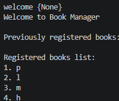

# Personal Book Manager


## Description
A Python-based application to manage and organize your personal book collection efficiently.

## Features
- Add books
- Display books
- Save books
- Read saved books
- Admin Mode
- Set task priority

## Task priority
each task can have one of these priority levels:
- low
- medium
- high

## Requirements
- Python
- `python-dotenv`

## Environment Setup
Create a `.env` file in the root directory of the project (you can use `.env.example` as a template).
Set your admin password using the following environment variable:

## Installation
To install the required packages, run the following command in your terminal:
```bash
pip install -r requirements.txt
```

# Screenshot

## Demo


## Project Structure

- `main.py`: Entry point of the application that runs the program.
- `books.py`: Manages book data, records, and related operations.
- `image/`: Stores project images, icons, and visual assets.
- `.gitignore`: Specifies intentionally untracked files that Git should ignore.
- `.env.example`: Template file showing required environment variables and configuration settings.
- `requirements.txt`: Lists all Python packages and external dependencies needed to run the project.

## How It Works

1. **Start**: The program asks for the user's name.
2. **Load Books**: It opens and reads the saved books list.
3. **Add Book**: The user can type a new book name and its priority.
4. **Show Books**: It shows the list of all books on the screen.
5. **Admin Mode**: Special settings for the admin.
6. **Save**: It saves all changes before closing.


## Troubleshooting

### 1. FileNotFoundError
- **What is it?** Python cannot find a file.
- **Why it happens?** The file is missing or named wrong.
- **What to check first?** Check if the file is in your folder.

### 2. JSONDecodeError
- **What is it?** The data file is empty or broken.
- **Why it happens?** The file was saved wrong or left blank.
- **What to check first?** Open the file and check if it is empty.

### 3. python-dotenv Not Found
- **What is it?** Python can't find `dotenv`.
- **Why it happens?** You did not install the package.
- **What to check first?** Run `pip install python-dotenv`.

### 4. Password Not Read from .env
- **What is it?** The program can't read your password.
- **Why it happens?** The `.env` file is missing or the name is wrong.
- **What to check first?** Make sure the `.env` file exists.