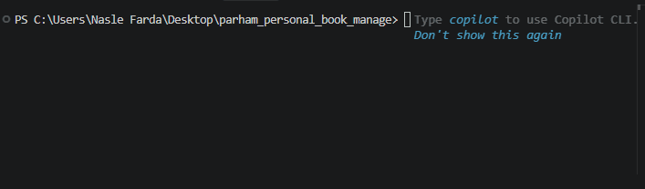

# Pesonel Task Manager
A simple task maneger built with python

# Features 
- add multiple tasks
- save tasks 
- load save tasks
- admin mode

# Requirements
- Python
- python-dotenv

# Installation
Install the required packages

```bash
python -m pip install -r requirments.txt
```

## Envoirment setup

create a `.env` file in the

project folde Use `.env.example` as a template

Add your admin password

```env
admin_pass=your_password_here
```

replace `your_password_here` with your own admin password

## run the program
run the main file:
```bash
python main.py
```

## Screenshot


## demo
